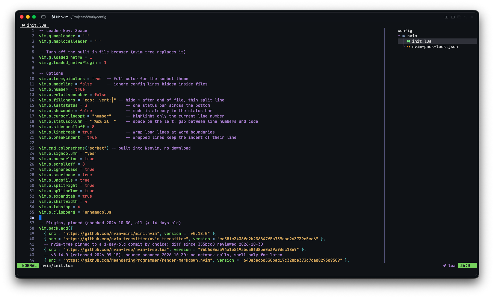
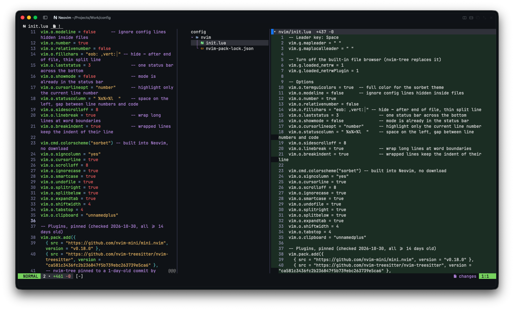
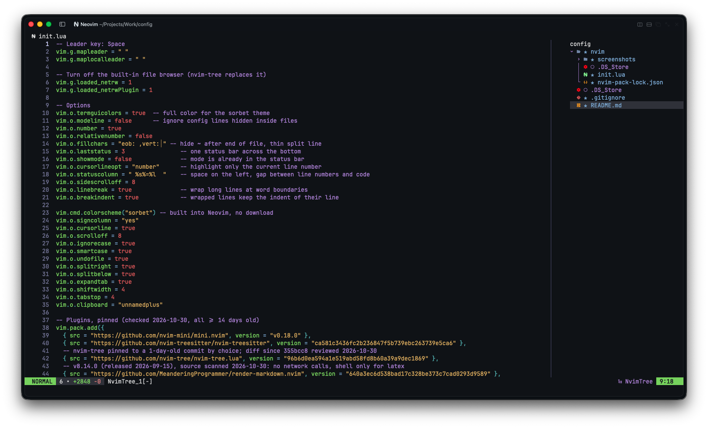

# config


My Neovim config. I wanted something as few plugins as possible and reeally minimal. It is a small minimal setup for writing code, with a quiet look and simple style git changes


## Contents

| Path | What it is |
|---|---|
| `nvim/init.lua` | The whole config, in one file |
| `nvim/nvim-pack-lock.json` | Exact plugin commits, written by `vim.pack` |
| `nvim/screenshots/` | Images for this README |

## Requirements

- Neovim 0.12 or newer. The config uses the built-in `vim.pack` plugin manager.
- `git`, for plugins and the changes panel.
- A terminal with transparency, for the glass look. Optional.
- macOS, for two features: images open in Preview, and discarded new files go to the Trash.

## Install

1. Copy the folder into place:
   ```sh
   mkdir -p ~/.config/nvim
   cp nvim/init.lua nvim/nvim-pack-lock.json ~/.config/nvim/
   ```
2. Open `nvim`. It downloads each plugin at the pinned commit.
3. Restart `nvim`.

## Features

### Glass look

- The theme is `sorbet`, which is built into Neovim.
- The editor, gutter, file tree, status bar, and tabline have no background. The terminal background shows through.
- Popups (file finder, file browser) use the editor text color, not the theme's light gray.
- The status bar shows the mode, git branch, change count, file name, file type, and cursor position.
- Bold text is removed everywhere, except markdown `**bold**` and headings.

### Markdown

- `render-markdown.nvim` draws headings, bullets, checkboxes, code blocks, and tables in the buffer. The line under the cursor shows raw markdown.
- Each heading level has its own color and is bold. There is no heading background bar.
- LaTeX rendering is off. It is the only part of the plugin that runs outside programs.
- Spell check is on for markdown files only.

### Images and PDFs

`.png`, `.jpg`, `.jpeg`, `.gif`, `.webp`, `.ico`, and `.pdf` files open in Preview. Neovim does not open them as text. `.svg` files open as text, so you can edit them.

### Git changes panel



`Space gs` opens a panel on the right. It works like the changes view in Warp:

- Each changed file gets a card with its path and a `+added -removed` count.
- Lines show real line numbers. Added lines are green. Removed lines are red.
- New files that git does not track yet show as all added.
- Files in `.gitignore` do not show.

The status bar also shows a repo-wide count, for example `2 • +461 -0`. That means 2 files changed, 461 lines added, and 0 lines removed. It updates when you save, switch files, or come back to Neovim.

### Git status in the file tree



The file tree shows the git status of each file. File names are colored by status, and a mark shows before each name:

| Mark | Meaning |
|---|---|
| `★` | New file. Git does not track it yet. |
| `✗` | Changed since the last commit |
| `✓` | Staged and ready to commit |
| `◌` (dimmed) | Ignored by `.gitignore`. Git never commits it. |
| No mark | Tracked and not changed |

Ignored files stay visible, so you can confirm that git skips them. Press `R` in the tree to refresh the marks.

## Shortcuts

The leader key is `Space`. Press `Space` and wait, and a popup lists every shortcut.

### Find

| Keys | Action |
|---|---|
| `Space Space` or `Space ff` | Find files |
| `Space fg` | Search text in the project |
| `Space fw` | Search the word under the cursor |
| `Space fb` | Open buffers |
| `Space fr` | Recent files |
| `Space fh` | Help |
| `Space fk` | Search all shortcuts |
| `Space fc` | Resume the last search |

### Files

| Keys | Action |
|---|---|
| `Space e` | Toggle the file tree (right side) |
| `Space E` | Show the current file in the tree |
| `-` | Quick file browser popup |

In the file tree:

| Key | Action |
|---|---|
| `a` | Create a file. End the name with `/` to create a folder. |
| `r` | Rename |
| `x`, then `p` in another folder | Move |
| `d` | Delete |
| `Enter` | Open |

### Git

| Keys | Action |
|---|---|
| `Space gs` | Open the changes panel |
| `Space gd` | Show the diff inline in the current file |
| `Space gc` | List the changed lines in the current file |
| `]h` / `[h` | Go to the next / previous change |
| `:Git status` | Show changed and new files |

In the changes panel:

| Key | Action |
|---|---|
| `Enter` on a line | Open the file at that line |
| `Enter` on a file header | Fold or unfold the file |
| `x` | Discard all changes to the file. It asks first. |
| `r` | Refresh |
| `q` | Close |

Note: `x` cannot be undone for a tracked file. The file goes back to the last commit. A new file goes to the macOS Trash, so you can get it back.

### Everyday

| Keys | Action |
|---|---|
| `Space w` | Save |
| `Space q` | Quit |
| `Esc` | Clear the search highlight |
| `Ctrl h` / `j` / `k` / `l` | Move between windows |
| `J` / `K` in visual mode | Move the selected lines down / up |

### Spell check (markdown)

| Keys | Action |
|---|---|
| `]s` / `[s` | Go to the next / previous typo |
| `z=` | Show suggestions |
| `zg` | Add the word to your dictionary |

### Editing helpers (mini.nvim defaults)

| Keys | Action |
|---|---|
| `sa` + motion + character | Add quotes or brackets. For example, `saiw"` wraps a word in quotes. |
| `sd` + character | Delete the quotes or brackets around the cursor |
| `sr` + old + new | Replace the quotes or brackets |
| `ci(`, `daq`, `yif` | Extra text objects for brackets, quotes, and function calls |

Brackets and quotes close by themselves when you type them.

## Plugins

| Plugin | Pinned to | Used for |
|---|---|---|
| [mini.nvim](https://github.com/nvim-mini/mini.nvim) | `v0.18.0` | Icons, status bar, tabline, picker, file browser, git, diff, pairs, surround, text objects, shortcut popup |
| [nvim-treesitter](https://github.com/nvim-treesitter/nvim-treesitter) | `ca581c3` | Syntax highlighting |
| [nvim-tree.lua](https://github.com/nvim-tree/nvim-tree.lua) | `96b6d0e` | File tree on the right |
| [render-markdown.nvim](https://github.com/MeanderingProgrammer/render-markdown.nvim) | `640a3ec` (v8.14.0) | Markdown rendering |

### Update policy

- Each plugin is pinned to an exact commit. A later push to a plugin repo cannot change what gets installed.
- Pin only commits that are at least 14 days old.
- Read the source of a new plugin before the first launch. Look for shell, network, and file-write calls.

To update a plugin:

1. Change its `version` in `init.lua`.
2. Open `nvim`. It downloads that commit and updates `nvim-pack-lock.json`.
3. Commit both files together.
